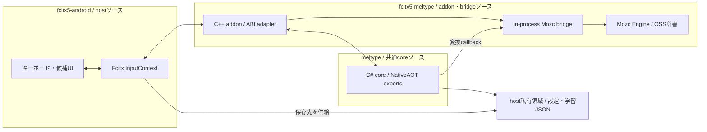
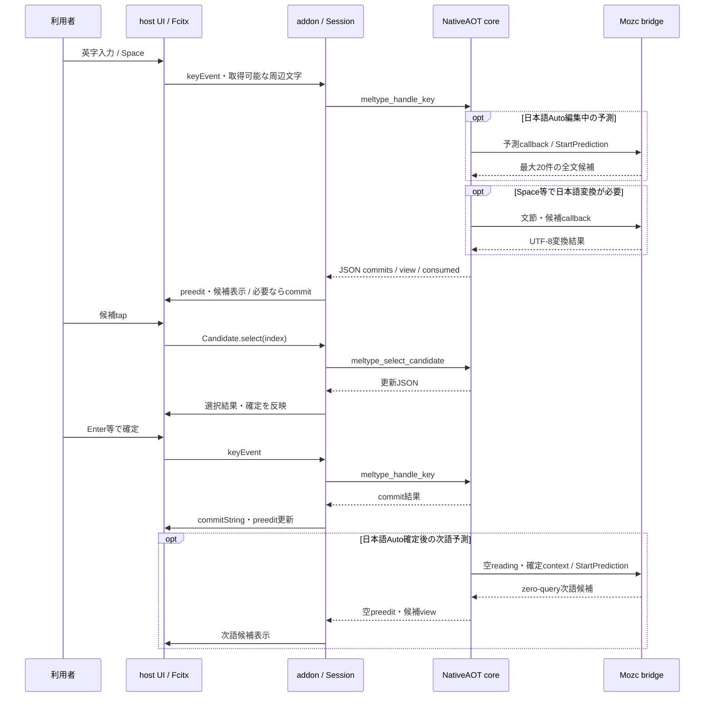
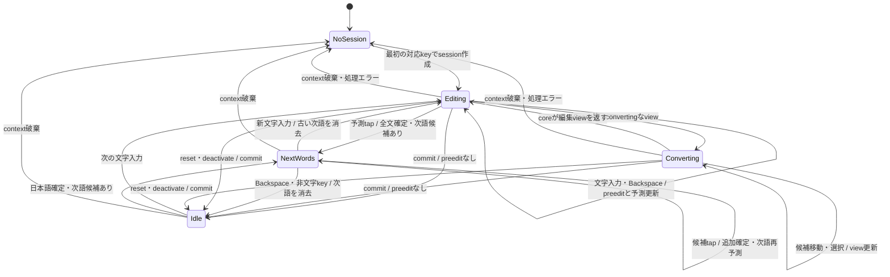
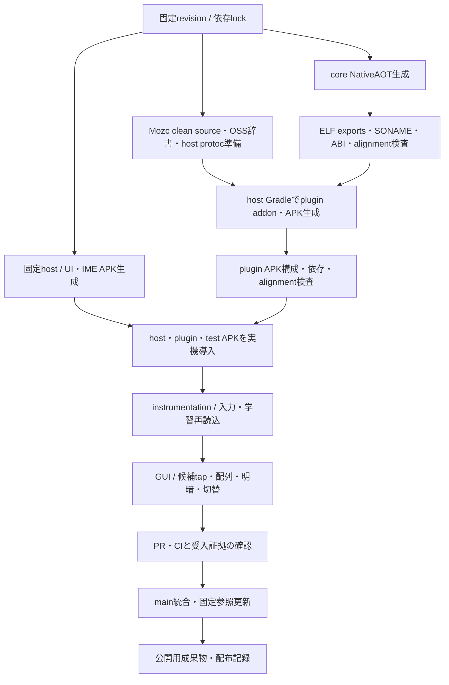

# 基本設計

Fcitx5の入力・候補UI、Meltypeの混在入力判定・ローマ字・学習、Mozcの日本語変換を組み合わせる。[要求定義](REQUIREMENTS.md)のR-01〜05と[要件定義](SPECIFICATIONS.md)のS-01〜09・NF-01〜04に対応する。依存revisionと再現手順は[BUILD](BUILD.md)、合否と実行記録は[TESTING](TESTING.md)を正本とする。

## 実装と公開の状態

予測対応の実装根拠はplugin `64009ff`、製品host `047277e6`、core `353995a`。試験修正host `1e0295f9`は製品コードを変更していない。Android統合branchと既存main公開PR core #8 / plugin #11を区別し、main公開済みとは扱わない。今回版の端末・CI・公開状態は[TESTING](TESTING.md)を正本とする。

## ソース所属と3リポジトリの責務（S-01・S-08・S-09）

|正本|所有する実装|他repoとの境界|
|---|---|---|
|[fcitx5-meltype](https://gitea.honya.dev/honya-dev-forks/fcitx5-meltype)|C++ addon、ABI/JSON adapter、Android factory、Mozc bridge、plugin APK定義、依存lock・検証script|coreの公開C ABIを呼ぶ。hostへ入力方式と候補eventを提供する|
|[fcitx5-android](https://gitea.honya.dev/honya-dev-forks/fcitx5-android)|IMEサービス、キーボード・候補UI、plugin発見・ロード、保存先供給、Gradle module登録|pluginは固定gitlinkで参照する。レイアウトやthemeをaddonへ持ち込まない|
|[Meltype](https://gitea.honya.dev/honya-dev-forks/meltype)|共通C# core、混在入力、ローマ字、session、学習・設定、NativeAOT exports|FcitxのUIやAndroid APK packagingを共通coreへ持ち込まない|

この図の枠はソースの所属を示し、APK収録先を示さない。pluginのaddon、Mozc bridge、NativeAOTはhost IME processにロードされ、別serviceや外部helper processを起動しない。Linux providerは既存の外部Mozc helper経路を使う。

## Android APK収録と実行先（S-07）

```mermaid
%%{init: {"themeVariables": {"fontFamily": "IBM Plex Sans JP"}}}%%
flowchart LR
    subgraph HostAPK[host APK]
        UIH[IMEサービス・キーボードUI]
        FH[Fcitx共有ライブラリ・STL]
    end
    subgraph PluginAPK[plugin APK]
        ADD[libmeltype.so / addon・Mozc bridge・静的engineと辞書]
        NAT[libMeltypeNative.so / NativeAOT provider]
        AS[addon・inputmethod設定・ライセンス]
    end
    subgraph Process[host IME process]
        LOAD[Fcitx addon loader]
        RUN[addon・provider・Mozc実行]
    end
    UIH --> LOAD
    FH --> LOAD
    ADD --> LOAD
    NAT --> RUN
    AS --> LOAD
    LOAD --> RUN
```

`libMeltypeNative.so`のソースはmeltype repoに所属するが、生成したproviderはplugin APKへ収録する。Mozc OSS辞書は生成headerから静的engineへ組み込まれ、独立した辞書assetとして配置する設計ではない。addon/bridge/辞書と同じplugin APKに配置し、host APKへproviderを重複収録しない。pluginはhostのFcitx共有ライブラリ/STLを利用し、実行時は両APKのライブラリがhost IME processで動く。LinuxではAPKを使わず、addonと指定provider/helperを[Linux手順](../addon/README.md)で配置する。

## 起動・保存先（S-02・S-05）

hostはAPI 24以上でdevice-protected storageの私有領域の絶対パスを`MELTYPE_DATA_DIR`へ供給する。Android factoryは保存先を検査し、`meltype_set_data_directory`、`meltype_mozc_bridge_init`、`meltype_init`の順に初期化してEngineを作成する。Mozc profileはその保存先の`mozc/`に置く。設定・学習はplugin APK自身の領域ではなくhostが書ける領域へ保存する。

`meltype_init`は文節変換・候補callbackを登録する。isWord callbackは`nullptr`であり、専用のAndroid英語辞書providerを実装したことにはならない。bridgeはprocess内で同じprofileへの再初期化を許容し、異なるprofileへの再初期化は失敗する。初期化失敗時はfactoryがエラーを返し、入力内容や保存先をログへ出さない。

Meltype側の学習JSONと再読込を実装した。Mozc固有のlearn/save callbackは現行ABIにないため未対応であり、両者を区別する。再起動後の学習確認手順は[Android受入](https://gitea.honya.dev/honya-dev-forks/fcitx5-meltype/src/commit/14cbeaabef946c160ecc67004a9b49b4a0a39218/android/README.md#実機受入)と[TESTING](TESTING.md)を参照する。

実装根拠: pluginの`addon/android_factory.cpp`・`native/mozc_bridge.cc`、coreの`src/Meltype.Mac.Native/Exports.cs`。これらのAndroidファイルは実装ブランチに存在し、文書mainだけでは参照できない場合がある。

## 入力・変換・候補・確定（S-03・S-04・S-11・S-12）

addonはFcitx keyをWindows VK・UTF-16文字・modifier bitへ変換する。最初の対応keyでInputContextごとのsessionを遅延作成し、coreへ渡す。未確定文字がないときだけ取得可能なsurrounding textをbefore/afterへ渡す。password/sensitive欄はcoreへ渡さず、通常の入力経路へ返す。

coreのJSON結果から`commits`の削除と文字列確定、`view`のpreedit・候補を反映する。hintはLinuxへだけ反映し、Androidは「Space 確定＋空白」等の操作説明auxUpを出さない。候補リストは`converting=true`かつ候補が複数のときに表示し、候補indexをcoreへ戻す。JSONの`consumed`がtrueの場合だけkey eventを受理する。

予測候補tapは全文を即確定する。通常Space変換の候補tapは文節選択を更新し、Enterで全文を確定する。図は代表操作の連携を示し、すべてのkeyを固定した状態遷移仕様に置き換えない。

ここでEditing/Converting/Idleは表示上の状態で、addonが保持する独立enumではない。reset/deactivateはcommitしてsessionを保持し、context property破棄はsessionをdestroyする。エラー時はsessionを破棄してUIをクリアし、次の対応keyで再作成する。

実装根拠: pluginの`addon/engine.cpp`・`addon/session.h`。非BMPや未対応keyは入力順序を保つため既存preeditをcommitしてから通常経路へ返す。削除位置はUTF-16単位からUnicode文字数へ変換し、surrogate pair分割や範囲超過を拒否する。

## ABIと安全境界（NF-01・NF-02）

文字列はUTF-8 NUL終端。coreが返すJSONはadapterが`meltype_free`で解放する。callbackの文字列はC++側がmallocし、C#側がfreeする。変換失敗はNULL、候補は改行区切り、文節は`読み\t結果`の改行区切りで渡す。Linux helperのUS/RS protocolをAndroid callbackへそのまま流さない。

任意export `meltype_set_prediction_callback`を最初のsession前に登録する。予測は既存変換callbackと分け、pure日本語Auto編集中の全文だけを対象にする。Androidの操作説明hint非表示はaddonのcompile-time境界で行い、core/providerや候補・キー・Linux表示を変更しない。入力途中の横候補とtap確定をPOBOX参考の範囲とし、確定後の次語予測もユーザー2026-10-11要求として実装する。callbackはreading/contextの2引数で、空readingでは直前最大20文字の日本語確定文脈を渡す。bridgeはReconstructHistoryとContext.preceding_text、zero_query_suggestion/mixed_conversionを空query時にのみ指定する。次語tapは追加文字列を確定し連続予測し、新打鍵・空Backspace・フォーカス変更で消去する。候補なしの文脈は非表示。部分候補を無効にし、prefix補完を同一読みの学習へ誤登録しない。F6/F7は予測を抑制し、F10の一回変換はpluginがcontext単位に追跡する。

core exportは排他を提供しないため、呼出しはFcitx event threadで直列化する。callback・bridgeはsessionより長いprocess寿命を持つ。C++/managed例外は各ABI境界で失敗値へ変換し、hostへ漏らさない。addonは結果の削除範囲をすべて検証してからアプリの文字列を編集する。

開発・ビルドは分離checkout/worktreeを使う。Mozc sourceはstagingへコピーしてAndroid用変更を適用し、元repo・dirty submodule・既存成果物を上書きしない。

## ビルドと配布（S-07・NF-03・NF-04）

Android pluginの対象はarm64-v8a / API 24以上。hostの全ABIへ自動展開しない。NativeAOTとaddonを同じplugin APKへ収録し、addonは`RUNPATH=$ORIGIN`からproviderを解決する。Fcitx共有ライブラリとSTLはhostが所有し、pluginへ重複収録しない。SDK/NDK等の値やコマンドは[BUILD](BUILD.md)・[Androidビルド](https://gitea.honya.dev/honya-dev-forks/fcitx5-meltype/src/commit/14cbeaabef946c160ecc67004a9b49b4a0a39218/android/README.md#ビルド)を正本とする。

後半は完了までの工程で、すべての段階が現在成功済みという図ではない。ELFの16KB LOAD alignmentやAPK構成検査の成功は、16KBページサイズ端末での起動成功を意味しない。min API実機・未確認端末・CIの状況は[TESTING](TESTING.md)を参照する。

pluginはGPL-3.0-or-laterとしてMeltype由来のCopyright 2026 Yukishiroと[NOTICE](../NOTICE)、第三者ライセンス原本を保持する。依存更新・公開境界は[BUILD](BUILD.md#依存更新と公開)を参照する。

## キーボードの設計（S-06）

ユーザー要求の出所は[plugin #10](https://gitea.honya.dev/honya-dev-forks/fcitx5-meltype/issues/10)、実装範囲は[host #9](https://gitea.honya.dev/honya-dev-forks/fcitx5-android/issues/9)。ATOK参考のQWERTY・数字行・主画面`@`と句読点・記号面・左右カーソルを維持し、Gboard参考のキー背景分離・余白・角丸を採用した。キー文字にはIBM Plex Sans JPを同梱する。候補欄はFcitxの既存UIとPixel配色を使う。

寸法・設定・既存設定保持はhostの`HONYA.md`、`ThemePrefs.kt`、`KeyView.kt`が正本。キーボードのタッチ領域は維持し、外観のinsetだけを調整する。12キー/フリックの採用は未決定であり、今回のQWERTY実装に含めない。[受入](TESTING.md#hostキーボードの設計受入)で入力結果・候補tap・明暗を確認する。

[ビルド](BUILD.md) / [検証](TESTING.md) / [文書一覧](README.md)

### Linux addonの直接英字状態

`addon/engine.h`のInputContext property `State.direct` が直接英字モードを保持する。coreのNonConvert/Convert定数にはモード切替実装がないため、adapterでpending commit後に状態を変更し、直接モードの通常キーをcoreへ送らずアプリへ通す。core/session ABIやproviderを変更しない。InputMethodEngineV2のsubMode/labelで `A` と `あ` を表示する。既存reset/deactivateのcommit処理は維持しdirect状態は変更しない。

### Android画面・物理キーの直接英字接続（S-10）

Linuxと同じState.directを使い、NativeAOT providerは固定87b1のまま変更しない。host TextKeyboardはMeltype時のみ専用キーを表示し、native statusでsubMode.labelがAなら復帰用Henkan、通常ならMuhenkanを送る。既存SymActionのVirtual入力を使用し、未消費文字はAndroid frontendのKeyEventからIME serviceがアプリへ確定する。GenKeyMappingは物理KEYCODE_MUHENKAN/HENKANにも同じsymを割り当てる。記号面ABCのlayout移動とLanguageKeyのIME切替は独立して維持する。
